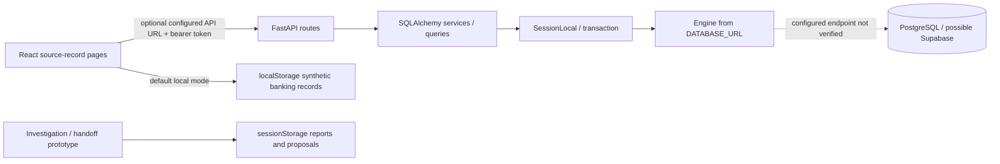

# OCBC IntelliOps — Database Implementation & Supabase Readiness Audit

Audit date: 10 November 2026, Asia/Singapore. Scope: current repository source, migrations, dependency metadata, database tests and relevant frontend integration. **Audit only:** no application/configuration/environment files changed; no environment variable assignments, application startup, database connections, table creation, migrations, seeds or Supabase requests were performed. Public documentation was consulted for provider requirements; this did not access a Supabase project.

## 1. Executive Summary

**Supabase readiness classification: PARTIALLY READY.** The PostgreSQL/SQLAlchemy implementation is substantial and portable in source, but connection readiness has not been established by execution. The visible local setup is incomplete. No PostgreSQL or Supabase table existence or active connection is confirmed.

| Question | Evidence-based answer |
|---|---|
| Is PostgreSQL implemented? | PostgreSQL support is implemented in configuration/dependencies and ORM operations. Actual PostgreSQL use is NOT VERIFIED. |
| Is SQLAlchemy implemented? | Yes: engine, declarative Base, session factory, models, queries, transactional writes and row locks. `backend/shared/database.py:1`; domain services. |
| Is Alembic implemented? | Yes: configuration, metadata registration and six linear revisions covering all 16 domain tables. Applying them is NOT VERIFIED. New-revision generation has a missing template. |
| Are models defined? | Yes: 16 tables, with keys/constraints/indexes and migration column coverage verified statically. |
| Are tables confirmed to exist? | **NOT VERIFIED for every table.** No live database was queried. Model/migration presence does not establish actual creation. |
| Is PostgreSQL connected now? | **NOT VERIFIED.** This audit shell has no DATABASE_URL. Only `.env.example` exists in each backend/frontend directory; neither is automatically loaded as `.env`. Other processes/deployment environments were not inspected. |
| Is it already connected to Supabase? | No connection evidence found. Example targets localhost. No Supabase client/configuration was found. A remote connection remains possible through DATABASE_URL, but none was attempted. |
| Must the schema be rewritten before connecting? | No. The existing implemented payment/ledger/case subset already has migration coverage. Future AI/workflow/approval features require persistence work, but are not prerequisites for an initial isolated database connection. |

Immediate setup blockers: selected Python lacks `psycopg2-binary` and Alembic (also Faker); an actual backend connection configuration is absent from the inspected app directories; Supabase endpoint, TLS, permissions and connection mode are unvalidated. Frontend defaults to local simulation unless its backend API URL is configured. A `/health` response would not prove database availability: `backend/main.py:27` returns a constant without a query.

## 2. Database Architecture



`backend/database.py:1` and `backend/models.py:1` are compatibility exports. Actual infrastructure is `backend/shared/database.py`; domain definitions live in `backend/modules/{payment_processing,core_banking,intelliops}/models.py`. Importing `backend/models.py` registers all tables in one Base metadata. There is no repository abstraction layer; services and some route handlers issue SQLAlchemy queries directly.

The model tables have **no explicit schema namespace**. With a normal PostgreSQL search path they are expected in `public`; the actual role/search path is NOT VERIFIED. Root README's four logical schemas and 21-entity ERD are a blueprint, not the implemented physical schema (`README.md:471`, `:516`). There are no SQLAlchemy `relationship()` declarations: associations use foreign keys and explicit joins/get/select operations. This is a valid implementation style; absence of `relationship()` is not absence of referential integrity.

`get_db` uses `with SessionLocal() as db: yield db` (`backend/modules/core_banking/router.py:16`), closing sessions after requests. Writes use explicit `with db.begin()` in payment and case routes; context exit commits on success and rolls back on error. Legacy routes and seed/generator tools use their own SessionLocal contexts. `flush()` inside services does not itself commit; transaction ownership resides in callers.

No direct React-to-PostgreSQL connection exists. No Supabase SDK, Auth, Realtime, REST data client or Supabase migration configuration was found. Supabase can serve purely as the backend's PostgreSQL host without those SDKs.

## 3. Existing Database Tables

### 3.1 Definition, migration and creation status

Revision shorthand below: R1=`20261103_01`, R2=`20261103_02`, R3=`20261103_03`, R4=`20261103_04`, R5=`20261103_05`, R6=`20261103_06`. Corresponding files are in `backend/alembic/versions/` and listed in Section 5.

| Database Table | Model Exists | Migration Exists | Backend Usage | Actual DB Creation Verified |
|---|---|---|---|---|
| transactions | Yes — Transaction | Yes — R1 | Yes — payment generation/read/detection/correction | NOT VERIFIED |
| processing_events | Yes — ProcessingEvent | Yes — R1, R2 | Yes — source processing history | NOT VERIFIED |
| payment_instructions | Yes — PaymentInstruction | Yes — R2 | Yes — ownership/idempotency/scenarios | NOT VERIFIED |
| exception_batches | Yes — ExceptionBatch | Yes — R5 | Yes — synthetic generation batches | NOT VERIFIED |
| exception_batch_items | Yes — ExceptionBatchItem | Yes — R5 | Yes — batch/transaction correlation | NOT VERIFIED |
| ledger_records | Yes — LedgerRecord | Yes — R1 | Yes — legacy generator/detection/guards | NOT VERIFIED |
| customers | Yes — Customer | Yes — R1 | Yes — source ownership/read/seed | NOT VERIFIED |
| accounts | Yes — Account | Yes — R1 | Yes — balances/payment/corrections | NOT VERIFIED |
| ledger_journals | Yes — LedgerJournal | Yes — R1, R2, R6 | Yes — posting/read/detection/corrections | NOT VERIFIED |
| ledger_entries | Yes — LedgerEntry | Yes — R1 | Yes — account movements/journal validation | NOT VERIFIED |
| detection_rules | Yes — DetectionRule | Yes — R1 | Yes — enabled flag and case rule linkage | NOT VERIFIED |
| exceptions | Yes — ExceptionCase | Yes — R1, R2, R3 | Yes — detection/read/lifecycle | NOT VERIFIED |
| exception_case_actions | Yes — ExceptionCaseAction | Yes — R3 | Yes — durable case history | NOT VERIFIED |
| ledger_posting_remediations | Yes — LedgerPostingRemediation | Yes — R3 | Yes — missing-ledger correction outcome | NOT VERIFIED |
| exception_resolutions | Yes — ExceptionResolution | Yes — R4 | Yes — other direct correction outcomes | NOT VERIFIED |
| audit_events | Yes — AuditEvent | Yes — R2 | Yes — operational audit persistence/read | NOT VERIFIED |

Alembic normally manages an additional `alembic_version` bookkeeping table when migrations run; it is not one of the 16 application models and its actual existence is also NOT VERIFIED.

### 3.2 Keys, columns, relationships, constraints and indexes

Every table has the primary key shown below. PK and unique constraints imply PostgreSQL backing indexes; “indexes” below lists other explicit model/migration indexes. UUID PKs default to Python `uuid4` in normal ORM creation; seed IDs are deterministic `uuid5`. No UUID extension is required by these source definitions. Monetary fields use Numeric(18,2), not floating-point columns. Times use timezone-aware DateTime declarations, with UTC Python defaults where provided.

| Table / model source | Primary key and important columns | Foreign keys / relationship meaning | Constraints and explicit indexes | Migration coverage / using module |
|---|---|---|---|---|
| transactions — `backend/modules/payment_processing/models.py:11` Transaction | Integer `id`; reference, payment_reference, amount, currency, status, created_at | Parent of instructions/events/cases/legacy ledger and source journals | Unique reference; reference index, payment_reference index. No amount/status/currency CHECK here | R1; payment/core/intelliops |
| processing_events — same `:31` ProcessingEvent | Integer `id`; transaction_id, event_type, details, status, error_code, created_at | transaction_id → transactions.id; many events per payment | Index transaction_id; status/error nullable | R1 base; R2 status/error; payment/snapshot/investigation input |
| payment_instructions — same `:47` PaymentInstruction | UUID payment_id; transaction_id, sender_account_id, receiver_account_id, idempotency_key, request_fingerprint, original_payment_id, scenario_code, failure fields, completed_at, reconciliation_due_at | Unique transaction_id → transactions.id; sender/receiver → accounts.account_id; original_payment_id → own payment_id | Unique transaction_id and idempotency_key; sender != receiver CHECK; sender/receiver indexes | R2; payment/detection/correction |
| exception_batches — same `:65` ExceptionBatch | UUID batch_id; requested_scenarios JSON, count_per_type, status, created_by, created_at, completed_at | Parent of batch items | PK only beyond non-null columns; no request-level idempotency unique key | R5; payment batch service |
| exception_batch_items — same `:76` ExceptionBatchItem | Integer id; batch_id, transaction_id, scenario_code, sequence | batch_id → exception_batches; transaction_id → transactions | Unique transaction_id; batch_id index; no unique (batch_id, sequence) constraint | R5; payment batch service |
| ledger_records — `backend/modules/core_banking/models.py:11` LedgerRecord | Integer id; transaction_id, amount, currency, entry_type, created_at | transaction_id → transactions.id | Index transaction_id; not a balanced account journal; no account FK | R1; legacy generation/detection/correction guards |
| customers — same `:26` Customer | UUID customer_id; customer_ref, customer_name, customer_type, status, created_at | Parent of composite account ownership link | Unique customer_ref and (customer_id, customer_type); CHECK customer_type in INDIVIDUAL/BUSINESS | R1; core/payment party reads/seed |
| accounts — same `:40` Account | UUID account_id; account_ref, customer_id, customer_type, account_type, currency, opening_balance, status, created_at | Composite (customer_id,customer_type) → customers equivalents; parent of instructions/entries | Unique account_ref; customer_id index; SAVINGS/CURRENT CHECK; BUSINESS requires CURRENT CHECK | R1; core/payment/corrections |
| ledger_journals — same `:59` LedgerJournal | UUID journal_id; journal_ref, normal_transaction_id, source_transaction_id, payment_reference, currency, status, created_at, posted_at | source_transaction_id and normal_transaction_id → transactions.id; payment_reference is logical text, deliberately not FK | Unique journal_ref; unique nullable normal_transaction_id; payment_reference and source_transaction_id indexes | R1 base; R2 source FK/index; R6 normal FK/unique + created_at; core/payment/corrections |
| ledger_entries — same `:73` LedgerEntry | UUID entry_id; entry_ref, journal_id, account_id, side, amount, currency, description, posted | journal_id → ledger_journals; account_id → accounts | Unique entry_ref; journal/account indexes; CHECK amount>0; CHECK side Debit/Credit; balance and cross-row currency/party checks are service-level | R1; core/payment/corrections |
| detection_rules — `backend/modules/intelliops/models.py:11` DetectionRule | Integer id; name, exception_type, threshold, enabled | Parent of optional case rule link | Unique name; no unique exception_type or threshold CHECK | R1; detection reads enabled; threshold not currently consumed |
| exceptions — same `:25` ExceptionCase | Integer id; transaction_id, rule_id, exception_type, severity, status, evidence JSON, detection_key, created_at, updated_at, resolved_at, resolution_summary | transaction_id → transactions; optional rule_id → detection_rules | transaction_id index; unique partial uq_active_detection on detection_key WHERE status NOT IN RESOLVED/CLOSED; nullable keys not deduplicated by index | R1 base; R2 key/index; R3 lifecycle; case/detection/correction |
| exception_case_actions — same `:55` ExceptionCaseAction | Integer id; exception_id, action_type, actor, details JSON, created_at | exception_id → exceptions | exception_id index; append-only intent, no immutability trigger/permission definition | R3; case/detection/correction |
| ledger_posting_remediations — same `:67` LedgerPostingRemediation | Integer id; exception_id, journal_id, idempotency_key, status, created_by, created_at | exception_id → exceptions; journal_id → ledger_journals | Each of exception_id, journal_id, idempotency_key unique | R3; missing-posting remediation |
| exception_resolutions — same `:80` ExceptionResolution | Integer id; exception_id, resolution_type, idempotency_key, optional journal_id, status, details JSON, created_by, created_at | exception_id → exceptions; optional journal_id → ledger_journals | Unique exception_id, key, optional journal_id; separate uniqueness domain from missing-posting table | R4; mismatch/duplicate/payment-retry resolution |
| audit_events — same `:95` AuditEvent | Integer id; action, actor, reference, details JSON, created_at | Generic text reference; no typed case/run/user FK | reference index; no database append-only enforcement | R2; payment/detection/case/correction/audit reads |

Important relationship distinctions:

- Backend case public ID `CASE-*` is formatted from `exceptions.id`; frontend payment ID `TXN-*` maps to `transactions.reference`, while instruction payment_id is a UUID. `backend/modules/intelliops/service.py:15`, `:30`; `payment_processing/service.py:140`.
- Journal UUID and public `JRN-*` reference coexist. The detail route accepts either (`core_banking/router.py:104`). Multiple corrective journals for a source transaction are possible; normal_transaction_id uniquely restricts the normal-posting path only.
- Detection evidence is already persisted in `exceptions.evidence`; case history/details and resolution details use JSON. A new table is not necessary merely to store a note or single-case evidence object.
- Legacy single-sided ledger_records do not equal account-linked ledger_entries and are not converted into invented balanced journal postings.
- No foreign keys declare cascade deletion behavior. Deletion/retention should be designed explicitly before adding delete endpoints.

## 4. Database Configuration

| Check | Finding / source |
|---|---|
| DATABASE_URL loading | `load_dotenv()` then `os.environ['DATABASE_URL']` in `backend/shared/database.py:6`. Missing URL causes import failure; no fallback localhost URL in engine code. An inherited environment value normally takes precedence over dotenv loading. |
| Example target | `backend/.env.example:2` describes local PostgreSQL host 127.0.0.1, port 5432; credentials intentionally omitted from this report. It is a template, not proof of a configured running service. |
| Current visible app-directory files | Only `.env.example` found in backend and frontend. Audit shell DATABASE_URL is unset (presence check only; no value printed). An ancestor dotenv file, separately configured process or deployment environment has not been ruled out. |
| Remote PostgreSQL | Engine passes supplied URL directly; no hardcoded localhost/network restriction. A valid remote psycopg2 URL is supported in principle. |
| Engine | `create_engine(DATABASE_URL, pool_pre_ping=True)`; synchronous engine, appropriate for synchronous FastAPI handlers. Construction alone is not a successful network connection. |
| Sessions | sessionmaker bound to engine; autoflush=False, autocommit=False. Request dependency uses a context manager; write routes own explicit transactions. |
| Pooling | pre_ping exists. No explicit pool_size, max_overflow, pool_recycle, connect_timeout, pool_timeout override, pool class switch, per-deployment budget or shutdown-dispose hook is configured. Defaults therefore matter. |
| SSL | No explicit TLS option in code/example. URL query parameters can carry psycopg2 sslmode and certificate options; TLS is possible but not enforced by current configuration. |
| PostgreSQL driver | `psycopg2-binary>=2.9,<3.0` declared in `backend/requirements.txt:5`; NOT INSTALLED in selected Python. psycopg v3 URLs would require a driver/dependency change; retain explicit postgresql+psycopg2 for the existing dependency. |
| Secrets | Runtime environment/dotenv, not embedded engine credentials; `.gitignore:17` excludes `.env` variants while preserving example templates. No actual secret value was displayed. No production secret manager is configured in this repository. |
| Role / schema / RLS | No DB-role provisioning, GRANT/REVOKE, CREATE SCHEMA, search_path selection or RLS policy migrations. Effective deployment privileges and exposure are NOT VERIFIED. |
| Health | `/health` returns a constant and does not check DB connectivity, migrations or seed readiness (`backend/main.py:27`). |

SQLAlchemy documents psycopg2 TLS configuration through URI parameters, including sslmode=require. This fits the existing URL-driven engine without adding a Supabase SDK. [SQLAlchemy PostgreSQL/psycopg2 SSL documentation](https://docs.sqlalchemy.org/en/20/dialects/postgresql.html#ssl-connections)

No connection string containing credentials is reproduced here. Pool/session and TLS recommendations below are proposed future setup, not existing configuration.

## 5. Migration Status

### 5.1 Existing revisions

| Revision / file under backend/alembic/versions | Parent | Creates/modifies |
|---|---|---|
| `20261103_01_accounts.py` | None | Frozen original definitions for transactions, ledger_records, processing_events, detection_rules, exceptions, created with checkfirst; creates customers, accounts, ledger_journals, ledger_entries and ownership/account-entry constraints/indexes |
| `20261103_02_payments.py` | R1 | Adds journal source transaction FK/index; event status/error; case detection_key/partial unique index; creates payment_instructions with ownership/self-links/idempotency and audit_events |
| `20261103_03_missing_ledger_remediation.py` | R2 | Adds case updated/resolved/summary fields, backfills updated_at from created_at and sets non-null; creates case actions and missing-posting remediations |
| `20261103_04_all_exception_resolutions.py` | R3 | Creates exception_resolutions for non-missing-posting direct policies |
| `20261103_05_exception_batches.py` | R4 | Creates exception_batches and exception_batch_items |
| `20261103_06_normal_posting.py` | R5 | Adds unique nullable normal_transaction_id FK and non-null created_at with server-time default to ledger_journals |

Static checks confirm six unique identifiers, no missing parent and one head: `20261103_06`. All 16 model tables and their declared column names appear across these revisions. This is **column-name coverage**, not verification of deployed schema, exact reflected type/default/index parity or successful execution.

### 5.2 Configuration and theoretical fresh PostgreSQL support

`backend/alembic.ini:2` sets script_location relative to its own path and prepends backend to imports. `backend/alembic/env.py:2` imports Base/engine and the compatibility model registry, then supplies `target_metadata=Base.metadata` for online/offline contexts. Supplied test connections are honored. Omitting sqlalchemy.url in the INI is intentional because env.py uses the shared environment-driven engine.

On a fresh writable PostgreSQL target, the chain **appears capable of creating the current 16-table schema** once dependencies and configuration exist. The code uses compatible Numeric/UUID/JSON/timestamp types, foreign keys, checks, regular/partial indexes and additive ALTER operations. No Supabase-specific extension or superuser-only feature was identified. No migration imports future live ORM definitions into the frozen initial table definitions. No existing model was found without migration table/column coverage.

**This is not a verified `alembic upgrade head` success. That command was not run.** Missing driver/Alembic currently prevent normal local execution; PostgreSQL permissions, network/TLS and actual target contents are unknown.

### 5.3 Gaps and conflicts

1. **New migration generation is incomplete:** `backend/alembic/script.py.mako` is absent. Metadata is wired for autogeneration, but the standard revision-file generation workflow needs that template. Existing upgrade scripts do not need the template to execute. Restore it before creating future revisions; do not reinitialize over existing migration history. [Alembic tutorial](https://alembic.sqlalchemy.org/en/latest/tutorial.html)
2. **Unknown pre-existing tables:** R1 checks existence of five original tables without checking their exact structure; new ownership/ledger tables are created unconditionally. A pre-existing incompatible/partially created schema can therefore fail or diverge. Inspect target before applying; do not blindly stamp or rerun initialization.
3. **Separate managed Supabase schemas:** all application metadata is unqualified. Autogeneration against a target with extra tables needs scoped review so a generated revision does not propose dropping unrelated objects. No include_object/include_name filter exists in env.py. Do not accept generated destructive differences automatically.
4. **Migration defaults differ from client defaults:** ORM Python defaults are not general SQL server defaults. R6's server default remains distinct from model Python creation timestamps; historical rows get migration-time created_at, not reconstructed historical creation times.
5. **Offline SQL path has an inspection dependency:** R1 calls `op.get_bind()`/`MetaData.create_all(checkfirst=True)` rather than only declarative Alembic operations. A completely offline SQL-rendering workflow is not established; do not use offline rendering as the assumed deployment path without testing it. Online upgrades are the intended path reviewed here.
6. **Downgrades intentionally raise errors.** Plan forward migrations and backups instead of assuming automated rollback is available.
7. **Generator bypass:** `backend/generate_data.py:43` calls metadata.create_all and writes a legacy dataset independently of Alembic. It does not maintain an alembic_version history; do not use it as the normal Supabase schema deployment mechanism.

## 6. Backend Integration

Classification vocabulary: FULLY IMPLEMENTED, PARTIALLY IMPLEMENTED, MOCK DATA ONLY, NOT IMPLEMENTED, BROKEN, NOT VERIFIED. No PostgreSQL feature is classified FULLY IMPLEMENTED solely from source. “NOT VERIFIED” below means a meaningful SQL read/write path exists but has not been exercised against PostgreSQL. Broader features with known gaps are PARTIALLY IMPLEMENTED.

| Module / feature | Actual handler → service → database operation | Classification |
|---|---|---|
| Payment creation | POST `/api/payments` → `payment_processing/api.py:84 post_payment` → `submit:59` transaction → `service.py:44 create_payment`: select/lock accounts, check idempotency, add transaction/instruction/events/journal/entries/audit, flush; route commits | NOT VERIFIED |
| Payment reads/history | GET `/api/payments` + detail/events/related → `api.py:28`, `:107`, `:112`, `:120` → joined selects, party DTOs, event selects and grouped entry totals | NOT VERIFIED |
| Source scenario/batch generation | POST `/api/demo/payments/scenario` or `/api/demo/exception-batches` → admin-protected routes → `create_payment`/`batch.py:12 create_exception_batch` → same source tables plus batch/items/audit within transaction | NOT VERIFIED |
| Customer/account/ledger reads | Core routes → `core_banking/service.py:22 valid_journals`, `:38 account_query`, `:82 account_balance`; SQL grouped sums, ownership joins and valid journal entry selection | NOT VERIFIED |
| Normal journal integrity | Payment service → `core_banking/service.py:53 post_normal_journal`; reads persisted movements and checks exact parties, amount/currency/balance before setting Posted | NOT VERIFIED |
| Source workflow events/tasks | `backend/modules/workflow/README.md:3` explicitly reserved; no source model/service | NOT IMPLEMENTED |
| Legacy generation | `backend/generate_data.py:42 generate_data` → create_all, transaction/legacy ledger/event writes, local CSV labels; no normalized instruction/account ownership | PARTIALLY IMPLEMENTED |
| Detection / case creation | POST `/api/detection/run` → `payment_processing/api.py:132` transaction → `intelliops/detection.py:12 detect` selects source/rules/cases, adds case/actions/audit | NOT VERIFIED for current five conditions; missing workflow/approval/timeout rules NOT IMPLEMENTED |
| Case reads/evidence | GET `/api/exceptions` → case_dtos SQL join; GET `/api/exceptions/{case_id}` → get_case/case_detail → case/actions/resolution/journal selects | NOT VERIFIED |
| Case filtering/assignment | Case list has no search/filter arguments; model has no assignee; no assignment mutation | NOT IMPLEMENTED |
| Case status/notes/closure | POST notes/close → `intelliops/router.py:25`, `:45` explicit transaction → `service.py:51`, `:126`: locked case update + case action/audit rows | NOT VERIFIED under existing direct lifecycle; verification-aware closure PARTIALLY IMPLEMENTED |
| AI evidence | Shared banking snapshot reads source SQL; browser copies it into analysis snapshot | PARTIALLY IMPLEMENTED: real source retrieval exists, no investigation persistence |
| Investigation findings/root cause/proposal | Browser `investigation/service.js:33` and `analysis.js:68`; no backend route/model for results | MOCK DATA ONLY for stored/generated investigation output (deterministic evidence-based prototype, not SQL/LLM persistence) |
| Direct resolution effects/outcomes | POST `/api/exceptions/{case_id}/remediate` → admin route transaction → `intelliops/resolution.py:65`: case lock, replay checks, source/ledger changes and outcome/action/audit inserts | PARTIALLY IMPLEMENTED: actual SQL executors exist; no approval/run/verification records and weaker account locking than normal payment |
| Workflow definitions/runs/steps/status | No durable orchestration model or API; type-based correction dispatch/outcome records only | NOT IMPLEMENTED as workflow orchestration |
| Verification records | Immediate case RESOLVED assignment in `resolution.py:58`, `:85`; no verifier/result model | NOT IMPLEMENTED |
| Approvals/reviewer decisions/history/workflow links | No models/routes; preview UI | NOT IMPLEMENTED |
| Audit persistence/reads | Operational services add AuditEvent inside transactions; GET `/api/audit-events` and snapshot select latest 500; case timeline reads actions | PARTIALLY IMPLEMENTED: SQL path exists, live persistence NOT VERIFIED; actors are roles, no run/decision IDs or full failure coverage |
| Analytics/dashboard | No operations analytics query/API; payment/account UI counts source records; account balances use real SQL aggregation | PARTIALLY IMPLEMENTED for source summaries; workflow/SLA/verified-success analytics NOT IMPLEMENTED |
| Settings/users/roles | Two server environment bearer-token roles, no user/role/settings table or management API | NOT IMPLEMENTED as database-backed management |

Specific persistence/correctness risks carried into PostgreSQL deployment:

- Normal payments use account row locks; corrections lock cases but not all affected accounts. Account status/funds checks vary by branch (`payment_processing/service.py:59`; `intelliops/resolution.py:13`, `:128`). PostgreSQL concurrency remains untested.
- API replay and frontend recovery disagree: each frontend remediation attempt generates a new key, while backend replay expects the original stored key (`frontend/src/shared/data/bankingRecords.js:143`; `intelliops/resolution.py:40`). A committed correction followed by refresh failure can surface as an error and fail retry with 409.
- Legacy records without PaymentInstruction ownership cannot be automatically corrected (`intelliops/resolution.py:17`). Legacy PENDING timeout examples are not covered by current detection.
- Audit references are generic strings; role actor is not unique user identity. “Append-only” comments do not enforce immutability.
- Partial unique case index protects active keys, but detector suppresses keys already resolved/closed too. Recurrence behavior is a policy gap, not proof of ongoing monitoring.
- Detection can skip completed payments with a correctly referenced but invalid linked journal: presence prevents missing-posting condition and no valid journal means no mismatch comparison (`detection.py:35–48`). A linked record is not proof of a valid posting.

## 7. Frontend Integration

The frontend's `.env.example` leaves VITE_BANKING_API_URL commented out. `frontend/src/main.jsx:11` only calls the backend when that build-time variable exists. Otherwise shared banking data starts from fictional arrays/two transfers and persists in localStorage (`frontend/src/shared/data/bankingRecords.js:6`, `:58`, `:66`). API connection failures render an error/token prompt instead of silently falling back.

| Page | Frontend API Call | Backend Endpoint | Database Operation | Status |
|---|---|---|---|---|
| Accounts | startup `fetchBankingSnapshot`, shared store; client-side filters/detail | GET `/api/banking-snapshot` | Joined ownership + valid journal SQL sums; source selects | NOT VERIFIED in connected mode; MOCK DATA ONLY in default local mode |
| Ledger Journals | shared BankingRecords snapshot; refreshBackend on mount, every 10 seconds while visible, focus/visibility changes | GET `/api/banking-snapshot` | Journal/entry/source selects | NOT VERIFIED connected; MOCK DATA ONLY local |
| Payment Transactions | startup snapshot; createSyntheticPayment → paymentRequest; createExceptionBatch; runPaymentDetection | GET `/api/banking-snapshot`; POST `/api/payments`, `/api/demo/payments/scenario`, `/api/demo/exception-batches`, `/api/detection/run` | Source/ledger/event/batch writes; detection cases/actions/audit; refreshed snapshot | NOT VERIFIED connected; MOCK DATA ONLY local |
| Exception Center | shared snapshot; fetchExceptionCase; addExceptionNote; remediateException; closeException | GET `/api/banking-snapshot`, `/api/exceptions/{case_id}`; POST same case `/notes`, `/remediate`, `/close`; POST `/api/detection/run` | Case/evidence/actions/outcome selects and transactional lifecycle/source writes | PARTIALLY IMPLEMENTED overall; SQL execution NOT VERIFIED; remediation replay interface BROKEN |
| AI Investigation | Uses shared already-loaded records; startInvestigation/analyzeSnapshot; browser session persistence | No investigation endpoint | Source may originate in SQL snapshot; reports/proposals never written to SQL | MOCK DATA ONLY for investigation results; source retrieval PARTIALLY IMPLEMENTED |
| Resolution Workflows | session getHandoff or generic preview | No workflow endpoint | None; direct remediation occurs separately in Exception Center | MOCK DATA ONLY receipt; durable execution NOT IMPLEMENTED |
| Approval Center | Generic IntelliOpsPage | No approval endpoint | None | NOT IMPLEMENTED |
| Audit Trail | Shared snapshot via ExceptionRecords audit | GET `/api/banking-snapshot`; separate GET `/api/audit-events` exists but main page uses snapshot | Latest 500 AuditEvent selects | PARTIALLY IMPLEMENTED; connected DB behavior NOT VERIFIED; local events in simulation |
| Overview / Analytics | Generic IntelliOpsPage | No corresponding feature endpoint | None for operations metrics | NOT IMPLEMENTED |
| Settings / User Management | Generic preview; manual token prompt at bootstrap | Snapshot authenticates demo token; no user/settings endpoint | No user/settings persistence | NOT IMPLEMENTED as user management |

All active banking client endpoint strings inspected match actual registered route definitions. Specialized account/payment/ledger read APIs exist, but most frontend reads use the full snapshot instead of them. No missing-endpoint call was invented to explain the absent workflow/approval modules.

After successful connected mutation, `refreshBackend()` fetches and publishes the SQL snapshot using `useSyncExternalStore`; case actions also return a detailed object for drawer state. A response in React state is not itself a database commit—persistence comes from backend transaction exit. These paths are source-traced, not exercised in this audit.

Cross-page consistency: CASE/TXN/JRN identifiers are preserved and converted deliberately; original instruction UUIDs are resolved to payment references in `investigation/analysis.js:10`. INV IDs and handoff evidence are browser session records only. No persisted workflow-run or approval ID exists. General pages use cached source state; **Ledger Journals specifically has periodic/focus refresh** (`frontend/src/shared/components/BankingRecords.jsx:15`). It is incorrect to assume either universal real-time freshness or no polling anywhere. Multiple SQL queries in the snapshot also do not establish repeatable-read consistency under concurrent commits.

## 8. Missing Database Components

### 8.1 Current implemented scope: reuse existing entities

No existing model table or column is statically missing migration coverage. Current payment/account/journal/case-note/correction/audit persistence can use the 16 tables already defined. Reuse:

- transactions + payment_instructions for payment source/ownership/idempotency;
- ledger_journals + ledger_entries for balanced account movements;
- exceptions.evidence JSON for detected source facts;
- exception_case_actions for case notes and lifecycle history;
- existing correction outcome tables for executed direct outcomes, rather than pretending they represent pending AI proposals;
- audit_events for operational events, extending typed context/actor references when identity/orchestration is implemented.

Actual schema correctness requires future reflected PostgreSQL comparison, constraints/index review and migration execution; source column coverage alone cannot establish it.

### 8.2 Persistence absent from browser-implemented features

Investigation runs, evidence snapshots, findings, error/retry history and handoffs currently live in sessionStorage. To make these real backend features, add a durable investigation/report representation linked to cases and evidence. A report JSON payload may hold hypotheses/findings/proposal details; there is no need for one new table per text section. Decide whether proposals belong to that report or to versioned resolution plans based on independent lifecycle needs.

### 8.3 Future features that need schema/service design

| Requirement | Suggested approach, not mandatory exact table names | Blocking initial Supabase connection? |
|---|---|---|
| Source workflow/task/events | Add instances/tasks/events only as required by actual task/retry evidence | No; blocks the documented failed-workflow feature |
| Resolution definitions/plans/runs/steps | Versioned definition/plan plus durable run and step records; JSON for structured policy input/output where appropriate | No; blocks durable orchestration |
| Approvals/decisions | Request + decision history linked to case/run/action version and actor; use existing source approval evidence separately from resolution approval authorization | No; blocks human approval workflow |
| Verification | Persist outcome, checked evidence, time, policy/version and run/action relation; separate entity only if needed for independent repeated checks | No; blocks verified closure |
| Assignment/SLA/escalation | Extend case columns/action history and derive SLA where practical; avoid unnecessary tables | No |
| Users/roles | Choose external identity or application users/membership; do not duplicate Supabase auth.users if adopting Supabase Auth later | No for backend demo tokens; required for accountable multi-user approvals |
| Analytics | Aggregate current/future authoritative lifecycle data; add materialized views/rollups only after scale warrants them | No |
| Settings | Validated environment configuration first; persist editable policies/rules/versioning as requirements mature | No |

Database deployment components currently absent: runtime URL/TLS configuration in inspected app directories, selected Python driver/migration dependencies, role/grant/RLS/exposure policy, migration revision template, actual target reflection/health validation and PostgreSQL concurrency verification. Four physical schemas, vectors/embeddings, Supabase Auth and realtime subscriptions are optional architecture choices, not connection prerequisites.

## 9. Supabase Readiness Assessment

**Classification: PARTIALLY READY. Connection and actual schema remain NOT VERIFIED.**

| Criterion | Assessment |
|---|---|
| PostgreSQL-compatible ORM schema/queries | Source appears compatible: Numeric, UUID, JSON, timezone timestamps, foreign keys, partial unique index and transactional row locks. PostgreSQL execution not tested. |
| Remote URL support | Existing engine can accept a remote psycopg2 URL without rewriting database/session code. No host-specific branch blocks Supabase. |
| Driver | Declared correctly for psycopg2, absent in current selected Python. |
| TLS | Supported through URL parameters; no current enforcement/configuration. |
| Direct/session pooling | Fits persistent synchronous FastAPI in principle; choose endpoint based on network and deployment. |
| Transaction pooling | No explicit pool-class/budget adjustment; not a drop-in deployment assumption. Prefer the simpler persistent-server path initially. |
| Migration chain | All current table/column definitions covered; online PostgreSQL run and permissions not verified; template missing for new revisions. |
| Environment | No app-directory actual .env; audit shell URL unset. Supabase target/credentials not inspected or configured. |
| Extensions | No required pgcrypto, uuid-ossp, vector or other extension found; UUIDs created by Python. |
| Supabase managed schemas / exposure | No explicit schema/RLS/grant decisions; inspect provider exposure settings before exposing application tables. |
| Seed and frontend | Explicit modern account seed required for usable snapshot; frontend backend mode separately enabled. Changing DB URL alone does not replace browser storage. |

For a persistent backend, Supabase recommends a direct connection when reachable; an IPv4-only deployment can use the shared session pooler. Migrations are directed to the direct endpoint. Copy the actual host/user/port rather than composing a pooler hostname. [Supabase connection guide](https://supabase.com/docs/guides/database/connecting-to-postgres)

For autoscaling/serverless transaction pooling, Supabase's SQLAlchemy guidance recommends NullPool. Current code only sets pre_ping, so that deployment needs an explicit pooling decision/configuration change. Account for process/worker count in the total connection budget. [Supabase SQLAlchemy guidance](https://supabase.com/kb/troubleshooting/using-sqlalchemy-with-supabase-FUqebT)

Current models are not SQLite-only. SQLite is explicitly used by tests/connected demo fixtures; localStorage/sessionStorage are separate browser persistence paths; the legacy generator also writes CSV labels. None establishes a running PostgreSQL connection.

**Changing DATABASE_URL can select Supabase as host, but is not sufficient to establish readiness:** install dependencies, choose network/TLS/role policy, inspect/apply schema later, seed intentionally, verify real operations and separately enable frontend backend mode. Missing AI/approval/workflow features need not be finished before the first isolated synthetic connection.

## 10. Supabase Connection Requirements

The following is a **future execution plan only**. No commands in this section were run. No credentials are included. Steps that connect, migrate or seed require a later authorized setup task.

1. **Prepare a supported Python environment and dependencies.** From backend, later install requirements and requirements-dev using the selected interpreter; frontend later uses its lockfile. Current missing Python distributions are Alembic, psycopg2-binary and Faker. Choose a sufficiently current Alembic satisfying requirements (configuration uses path_separator); verify interpreter/package alignment. No source ORM rewrite or Supabase SDK is needed for direct SQL access. Files: `backend/requirements.txt`, `requirements-dev.txt`; `frontend/package.json`, `package-lock.json`.
2. **Choose an isolated synthetic Supabase project/target and inspect exposure/roles.** Keep FastAPI as the browser's data boundary. Use a migration-capable role for DDL and a limited runtime role for actual operations; runtime operations need table/sequence privileges and may need RLS policies depending on role. Decide which schemas are exposed through Supabase's Data API. No grants/policies are currently implemented. For exposed-schema tables, configure RLS/access deliberately; SQL-created tables do not automatically acquire an application's authorization policy. [Supabase RLS documentation](https://supabase.com/docs/guides/database/postgres/row-level-security)
3. **Choose connection mode from the project's Connect panel.** For a persistent FastAPI process, prefer direct connection if network reachability permits, or session pooler on IPv4-only networks. Use a direct migration connection from a suitable network. If considering transaction pooling, first implement/test the appropriate client pooling configuration and session-state limitations. The current code uses one DATABASE_URL for both app and Alembic; different runtime/migration URLs therefore need an explicit future configuration/deployment selection. Do not invent an already-supported MIGRATION_DATABASE_URL variable.
4. **Configure backend secrets and TLS later.** Supply DATABASE_URL through backend deployment secrets or an ignored backend/.env. Keep the explicit `postgresql+psycopg2` scheme and dashboard-supplied database/user/host/port, percent-encoding reserved password characters. Configure sslmode=require at minimum; for server identity validation use verify-full with the provider root certificate. Never place this URL in a VITE variable or commit it. [Supabase TLS guidance](https://supabase.com/docs/guides/database/connecting-to-postgres#ssl)
5. **Validate a read-only connection before DDL.** Later perform a backend-driver connection and `SELECT 1`; verify intended database/schema/user, negotiated TLS and actual table/revision state without printing credentials. Check that network restrictions permit the chosen endpoint. A successful SQL query is connection evidence; the current `/health` is not. Actual tables must be checked via information_schema/SQLAlchemy inspection after authorization.
6. **Review migrations against the actual target before applying.** Check existing objects, intended search_path and privileges. Preserve Supabase-managed schemas and existing data. With a fresh intended target, run from backend later:

   ```powershell
   python -m alembic history
   python -m alembic heads
   python -m alembic current
   python -m alembic upgrade head
   ```

   `current` and `upgrade` connect to the selected database; `upgrade` changes schema/data. Expected head from source: `20261103_06`. Do not stamp a populated unknown schema as a substitute for applying/reconciling migrations. Repair `backend/alembic/script.py.mako` before generating new revisions; do not run `alembic init` over this existing tree.
7. **Reflect and validate the result.** Later confirm the 16 domain tables plus migration bookkeeping, primary/foreign/unique/check constraints, partial index, column defaults and expected revision. Exercise PostgreSQL-specific row locking/concurrency on disposable synthetic data. Do not count isolated SQLite tests as PostgreSQL compatibility evidence.
8. **Seed the chosen modern demo dataset explicitly, later.** The UI rejects an empty account snapshot. After migration and target confirmation, run the existing module only when authorized:

   ```powershell
   python -m modules.core_banking.seed
   ```

   This loads fictional customers/accounts and linked payment/journal history from `backend/modules/core_banking/demo.json`; it refuses conflicting rows rather than silently overwriting them. Seed is not automatic app startup. Do not substitute `generate_data.py` blindly: it creates a separate legacy dataset, invokes create_all and lacks modern instruction ownership.
9. **Configure API credentials and start backend later.** Set distinct nonempty INTELLIOPS_ANALYST_TOKEN/INTELLIOPS_ADMIN_TOKEN through backend secrets; current code derives roles from these tokens, not Supabase Auth. Start FastAPI with the documented interpreter and inspect authenticated snapshot/account/payment reads. Avoid logging the full connection URL or tokens.
10. **Enable frontend backend mode separately.** Later set `VITE_BANKING_API_URL=/backend` for local Vite development and start/restart Vite; `frontend/vite.config.js` proxies that path to the configured FastAPI target. Browser token prompt authenticates API access. For static production hosting, provide the actual reverse proxy/base URL and CORS/SPA routing as needed; Vite's dev proxy is not production routing. DB passwords remain backend-only. Existing localStorage records are not automatically imported into SQL.
11. **Verify controlled persistence and recovery.** In an authorized synthetic test, create one payment, confirm journal/entries/events/audit, reload and cross-check account balances. Then test detection, case notes, permitted correction and replay/recovery. Use isolated PostgreSQL for concurrent writes. Record table/revision/read/write evidence separately from missing product features. Approval/AI workflow completeness remains a separate development milestone.

Risks to resolve during those steps: wrong DB/role or pre-existing tables; inaccessible endpoint/IP version; missing TLS verification; excess worker connections; unintended Data API exposure; absent runtime grants; data-generator/migration history mismatch; locked-account/concurrent corrective behavior; weak shared-role attribution; and frontend still running locally despite a successful backend connection.

## 11. Database Implementation Checklist

Checked items are verified source/static facts only where explicitly stated. No checked item implies a live connection or applied migration.

- [x] SQLAlchemy engine/Base/session factory source is implemented and inspected (`backend/shared/database.py`).
- [x] Sixteen model definitions are present; keys, foreign keys, checks and indexes inspected.
- [x] Six revision IDs form a linear chain with one head; all model table/column names covered by migration source.
- [x] Python source syntax: all 41 backend `.py` files parsed without executing application code.
- [x] Request session close and explicit write transaction patterns verified in source.
- [x] Declared PostgreSQL driver/Alembic requirements and actual selected-interpreter package availability inspected without installing anything.
- [ ] PostgreSQL connection — **Implemented but not verified**; audit shell URL unset, no connection attempted.
- [ ] Actual existence of every domain table and alembic_version — **Implemented definitions but not verified in a database**.
- [ ] PostgreSQL migration execution/reflected schema parity — **Implemented but not verified**; no migration run.
- [ ] Current Python environment — **Partially implemented**; driver/Alembic/Faker missing.
- [ ] New revision/autogeneration workflow — **Partially implemented**; metadata wired, script.py.mako missing.
- [ ] Explicit TLS/network/connection-mode/pool budget configuration — **Partially implemented**; URL support exists, actual settings unverified.
- [ ] Runtime/migration role grants and Supabase RLS/Data API exposure policy — **Not implemented in repository**, actual target policy unknown.
- [ ] Modern source seed and data preservation — **Implemented but not verified**; not executed.
- [ ] Backend SQL payment/case/audit operation results — **Implemented but not verified** against PostgreSQL.
- [ ] Corrective account concurrency and frontend replay recovery — **Partially implemented**, identified safety/contract gaps.
- [ ] Frontend database mode — **Implemented but not verified**; default remains local simulation.
- [ ] Investigation/proposal durability — **Not implemented**; sessionStorage prototype.
- [ ] Workflow instances/runs/steps, approvals/decisions and verification persistence — **Not implemented**.
- [ ] Database-backed users/settings/operational analytics — **Not implemented** beyond source counts and account aggregates.
- [ ] Database-aware health/readiness check — **Not implemented**; current health is constant.
- [ ] Supabase readiness validation — **Not verified**; overall source/setup readiness PARTIALLY READY.

### Verification record and limitations

This audit executed only source reads/searches, file-presence checks, git status/diff summary, Python AST parsing/static model-to-migration column comparison, and installed-distribution/presence-only environment inspection. Selected Python reports SQLAlchemy 2.0.36, FastAPI 0.135.1 and python-dotenv 1.2.2; Alembic, psycopg2-binary and Faker are absent. The AST comparison checks names, not live metadata reflection or exact DDL equality. No environment values were assigned or secret values printed.

Tests were **NOT RUN in this audit**: dependencies are missing, and the inspected suites create/seed isolated SQLite tables and execute migrations, while this request explicitly forbids table creation/migration/seed operations. Their isolation code was reviewed (`backend/tests/test_accounts.py:2`, `:25`, `:36`; `backend/tests/serve_demo.py:21`). Prior project-audit failures/passes are historical results, not newly executed checks or evidence of PostgreSQL/Supabase tables. No network endpoint was probed; public documentation research is the only web access.

## 12. Recommended Next Steps

### P0 — Critical connection/setup blockers

| Recommendation | Relevant files | Acceptance |
|---|---|---|
| Restore selected interpreter dependencies and document environment | `backend/requirements.txt`, `requirements-dev.txt`, `backend/README.md` | psycopg2/Alembic available in the same Python that starts FastAPI; isolated checks reproducible |
| Choose target/connection mode, supply ignored runtime URL and explicit TLS | `backend/shared/database.py`, `backend/.env.example`, deployment secrets | Future authorized SELECT 1 proves intended target + TLS; no secrets in frontend/source |
| Decide migration/runtime privileges and exposure policy | `backend/alembic/env.py`, migrations; new deployment/role documentation | Intended schema only; runtime sufficient limited privileges; exposed tables deliberately protected |
| Review and later apply existing migrations rather than rebuilding tables | `backend/alembic/versions/20261103_01_accounts.py` through `_06_normal_posting.py` | Fresh authorized target reflects all 16 tables/constraints and head `_06`; existing data preserved |
| Add a database-aware readiness check later | `backend/main.py`, shared database module | Readiness distinguishes unreachable DB/missing schema from constant process health without exposing credentials |

### P1 — Required database/API integration for the existing demo and planned workflows

| Recommendation | Relevant files | Acceptance |
|---|---|---|
| Restore revision template before future schema work | `backend/alembic/script.py.mako` (missing), `env.py` | Revision generation works in an isolated development setup; current history preserved |
| Seed modern synthetic data and enable frontend backend mode later | `backend/modules/core_banking/seed.py`, `demo.json`, `frontend/.env.example`, `src/main.jsx`, `vite.config.js` | Persisted accounts/payments/journals render after reload and source mutations refresh |
| Fix corrective locking/revalidation and stable replay recovery | `backend/modules/intelliops/resolution.py`, `core_banking/service.py`, `frontend/src/shared/data/bankingRecords.js` | PostgreSQL concurrent writers safe; lost-response retry returns original persisted correction |
| Add durable investigation/report and orchestration/approval/verification records incrementally | IntelliOps models/services/routes/migrations; `modules/workflow/`; frontend investigation adapter/PortalPage | Case-linked server history survives browser loss; approved verified actions drive lifecycle; no invented run/approval IDs |
| Improve audit identity/linkage and lifecycle rules | `backend/shared/security.py`, `intelliops/models.py`, `service.py`, audit reads/UI | Exact actor/action/run/decision/outcome trace; guarded closure and failure history |

### P2 — Improvements and optional components

| Recommendation | Relevant files | Acceptance |
|---|---|---|
| Bound snapshot/detection/audit queries and add consistent freshness | `core_banking/snapshot.py`, `intelliops/detection.py`, `payment_processing/api.py`, frontend store/pages | Paging and measured query cost; documented snapshot consistency; preserve existing ledger polling behavior |
| Add case search/assignment/SLA and real analytics | IntelliOps models/read APIs, `ExceptionRecords.jsx`, overview/analytics pages | Database-derived lifecycle metrics, no proposal counted as verified resolution |
| Reconcile legacy generator vs modern migrations/seed docs | `backend/generate_data.py`, root/backend README, migration report | Supported setup path explicit; legacy labels/records never imply missing features are implemented |
| Evaluate separate schemas/JSONB/rollups/external identity only when required | Domain models, future migrations/security/config | Benefit justified by access/query/lifecycle needs; no unnecessary schema rewrite for Supabase |

**Immediate next action:** perform a separate authorized environment-and-connection setup for an isolated synthetic Supabase target, following Section 10. Finish product persistence gaps incrementally afterward. No schema rewrite, Supabase SDK or completed AI/approval engine is required just to establish a backend PostgreSQL connection.
