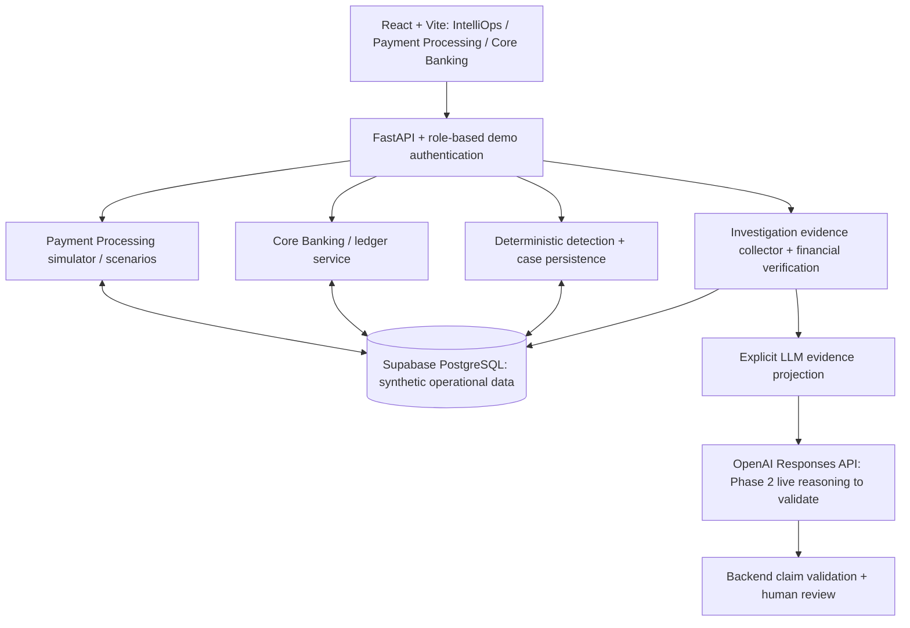
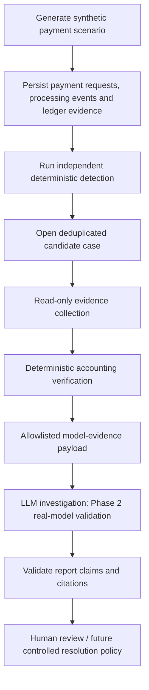

# OCBC IntelliOps

**Intelligent Operations — From Automation to Controlled Resolution**  
**Project:** Student innovation-challenge prototype  
**Environment:** Fictional/synthetic banking operations  
**Documentation snapshot:** 12 November 2026, before Phase 2 live-LLM investigation testing

> **Important:** This is an independent student prototype, **not** an official OCBC product or an account of OCBC's internal systems. Never connect this application to live banking infrastructure, use genuine customer data, or execute real transfers. All payments, accounts, postings, and exceptions are synthetic.
>
> **For teammates and coding assistants:** Read [Current implementation status](#current-implementation-status), [System architecture and data modes](#system-architecture-and-data-modes), [Duplicate-transaction scenarios](#duplicate-transaction-scenarios), [AI Investigation Phase 1](#ai-investigation-phase-1-evidence-and-llm-input-separation), and [Engineering guardrails](#engineering-guardrails) **before modifying code**. This README is a handoff based on the existing README, verified API examples and the team's latest test report; it is **not** an automated inventory of the current checkout. Inspect the repository and actual routes/models before making changes.

## Contents

- [Project overview](#project-overview)
- [Current implementation status](#current-implementation-status)
- [System architecture and data modes](#system-architecture-and-data-modes)
- [Portals and roles](#portals-and-roles)
- [Duplicate-transaction scenarios](#duplicate-transaction-scenarios)
- [Exception detection and investigation flow](#exception-detection-and-investigation-flow)
- [AI Investigation Phase 1: evidence and LLM-input separation](#ai-investigation-phase-1-evidence-and-llm-input-separation)
- [Representative verified cases](#representative-verified-cases)
- [Backend APIs and source locations](#backend-apis-and-source-locations)
- [Database and migrations](#database-and-migrations)
- [Local development and backend connection](#local-development-and-backend-connection)
- [Testing and verification](#testing-and-verification)
- [Engineering guardrails](#engineering-guardrails)
- [Next phase and team handoff](#next-phase-and-team-handoff)
- [Additional documentation](#additional-documentation)
- [Glossary](#glossary)

## Project overview

**OCBC IntelliOps** aims to help banking operations teams **detect, investigate, and safely resolve operational exceptions**, rather than merely display alerts. It correlates synthetic payment-processing records with synthetic core-banking ledger evidence, creates exception cases, and prepares evidence for AI-supported investigation. Later phases will propose, review, execute where explicitly permitted, verify, and audit resolution actions.

The visible product has three portals:

1. **Payment Processing:** Create synthetic payments and inspect payment status, requests, and processing history.
2. **Core Banking / Ledger:** Inspect fictional accounts, ledger journals, debit/credit entries, and calculated balances.
3. **IntelliOps:** Detect and review exceptions, retrieve investigation evidence, and eventually run LLM-assisted analysis and controlled resolution.

A workflow-engine simulator is part of the broader design, but its previously proposed end-to-end autonomous retry flow must **not** be treated as a verified deliverable on the basis of this handoff.

### Core principles

- **Detect with deterministic rules.** Similar-looking payments are *candidates*, not proof of wrongdoing or a financial error.
- **Investigate from source evidence.** Preserve request identity, event timing, authorization, journal references, and uncertainty.
- **Verify financial facts in code.** The LLM must not invent ledger totals or authorize accounting changes.
- **Separate investigation from action.** An AI explanation/recommendation is not permission to execute a reversal or change a balance.
- **Keep an auditable trail.** Do not silently alter historical postings or exception records.

## Current implementation status

This table distinguishes implemented/reported work from independently completed end-to-end outcomes.

| Area | Status at handoff | Evidence / limitation |
|---|---|---|
| React/Vite frontend with three portals | Existing implementation | Original README documents the portal shell and screens; inspect current components for exact UI behavior. |
| FastAPI backend + SQLAlchemy/PostgreSQL | Implemented; connected evidence reads demonstrated | Authenticated investigation-evidence GETs retrieved three existing cases. The team's final verification report states Supabase revision `20261111_08`. This does not automatically prove every frontend route is connected. |
| Synthetic payment and ledger scenarios | Implemented; A/B/C manually exercised | User verified transactions, journals and balances in the simulator; backend evidence responses for all three cases contain coherent request, event and journal records. |
| Duplicate detection / paired exception cases | Implemented for tested examples | Three detected cases link both payments and carry neutral `SUSPECTED_DUPLICATE` evidence with root cause `NOT_ESTABLISHED`. Full regression coverage should still be checked in the repository. |
| AI Investigation **Phase 1: evidence retrieval** | **Verified for three cases** | `GET /api/exceptions/{case_id}/investigation-evidence` returns meaningful structured evidence and financial verification. |
| AI Investigation **Phase 1: LLM-input separation** | **Reported passed** | Captured actual mocked OpenAI HTTP request bodies for cases A/B/C; 44 tests passed, 0 failed, 0 skipped in the opt-in verification run. No paid API request was made. |
| Phase 2: real OpenAI reasoning quality | **Not yet verified** | Mocked transport/structured responses do not establish live-model diagnostic accuracy, hallucination resistance, or consistency. |
| Automated financial remediation / autonomous closure | **Not established by Phase 1** | Do not claim that an AI diagnosis reverses payments, posts corrections, closes cases, or bypasses approvals. |
| Non-duplicate exception types | Existing options/code paths noted | Normal payment, Missing Ledger Posting, Amount Mismatch, Payment Processing Failure were preserved in the scenario specification; their current E2E status requires separate verification. |
| Workflow-engine automation, LangGraph orchestration | Earlier architectural plan | Verify actual code before describing these as implemented. The verified Phase 1 provider path uses an OpenAI Responses-compatible HTTP interface, not proof of LangGraph execution. |

**Scope of verification:** The team-supplied final Phase 1 report describes tests against three **existing** database-backed cases. It reports read-only live GETs, mocked in-process investigation POSTs, and no database writes. The claimed no-leakage result is specific to the inspected code path, data, and injection vectors; it is not a guarantee against future changes.

## System architecture and data modes



### Backend-connected mode (target default)

- The React UI calls **FastAPI**; backend services own synthetic payment generation, journal validation, detection, and evidence retrieval.
- **Supabase PostgreSQL** stores the fictional records. Financial balances are derived from appropriate posted ledger entries, not independently changed in the browser.
- All portals should display the **same payment IDs, journal IDs, and case links** returned by the backend.
- A failed backend call should show an error; it must **not silently fall back** to locally generated banking records.

### Browser-only mode (separate simulator)

- A browser-local simulation mode exists in the project. It is useful for offline UI testing and fallback demos.
- **Browser-only records are not Supabase records.** Success in this mode does not prove backend persistence or API parity.
- Do not merge browser-local records into server results or describe them as persisted; do not develop new IntelliOps investigation behavior against local mock data while claiming live backend verification.
- The previously documented frontend configuration switch is `VITE_BANKING_API_URL`; inspect the current frontend mode selection logic before changing it.

### Why the distinction matters

AI Investigation must retrieve the actual operational evidence for the case being investigated. A browser-only payment that never reached PostgreSQL cannot be independently retrieved by the database-backed evidence collector.

## Portals and roles

| Portal | Primary surfaces | Notes |
|---|---|---|
| **IntelliOps** | Overview, Exception Center, AI Investigation, Resolution Workflows, Approval Center, Audit Trail, Analytics | Some screens may be previews; verify actual API integration for each action. |
| **Payment Processing** | Transactions; Create Synthetic Payment; transaction overview, Processing History and related records | A/B/C scenario selection is under **Duplicate Transaction**. |
| **Core Banking / Ledger** | Accounts; Ledger Journals; journal details and debit/credit lines | Balanced individual journals are required; a missing/incorrect posting must not be fabricated to reconcile a case. |

Two demo roles are documented: **Operations Analyst** (read/investigate/review) and **Administrator** (additional privileged simulation/approval operations where implemented). Enforce permissions on the **server**, not just by hiding UI buttons. The specific investigation route may accept either role depending on current route code.

## Duplicate-transaction scenarios

The current priority is **Duplicate Transaction**, with three deliberately different explanations. The simulator generates **evidence**; detection must not be supplied with a private, prewritten diagnosis.

| | A — Customer Double-Click | B — Automatic Retry Failure | C — Legitimate Repeated Payments |
|---|---|---|---|
| Customer intent | Transfer once | Transfer once | Transfer twice independently |
| Submission source | Two `CUSTOMER` attempts | One `CUSTOMER` attempt, one `SYSTEM` retry | Two independent `CUSTOMER` attempts |
| Business instruction | Shared anchor | Shared anchor | Two separate instruction anchors |
| Payment statuses | `Completed` + `Held` | `Completed` + `Completed` | `Completed` + `Completed` |
| Posted journals | **1** | **2** | **2** |
| Ledger entries | **2** | **4** | **4** |
| Effect for transfer amount `A` | Sender −`A`, receiver +`A` | Sender −`2A`, receiver +`2A` | Sender −`2A`, receiver +`2A` |
| Distinguishing evidence | Delayed client confirmation, second customer submit, duplicate match, hold before posting | Acknowledgment timeout, scheduled system retry, incorrect duplicate-control lookup, second posting | Distinct authorizations, separate instruction IDs, no retry link |
| Intended investigative interpretation | Duplicate execution prevented | Potential unintended duplicate financial execution | Potential **false-positive** duplicate alert; two postings may both be authorized |

### Scenario A — Customer double-click; second request held

The original payment completes and creates one balanced journal. Client confirmation is delayed and the customer submits again. Duplicate protection recognizes the previously processed business instruction and **holds the second request before posting**. The held payment has no posted journal and does not change the balance. Detecting a possible duplicate does **not** mean a second transfer occurred.

Relevant event types observed in a tested case include `CLIENT_SUBMISSION`, `CLIENT_CONFIRMATION_DELAYED`, `DUPLICATE_CONTROL_MATCH`, and `DUPLICATE_BLOCKED`.

### Scenario B — Automatic retry with duplicate posting

A customer submits once and the original payment posts. An acknowledgment timeout triggers a **system-origin** retry. The synthetic instruction replay check misses an existing execution and a second distinct payment also posts. Both individual journals are balanced, yet the cumulative financial movement exceeds the **single** intended transfer.

Relevant observed event types include `ACK_TIMEOUT`, `RETRY_SCHEDULED`, `RETRY_SUBMITTED`, `IDEMPOTENCY_CHECK_FAILED`, and two `LEDGER_POSTING_CONFIRMED` records.

**Safety:** The defect is an explicitly controlled *synthetic fault*, not permission to weaken normal idempotency, remove uniqueness constraints, or expose a general bypass in normal payment processing.

### Scenario C — Legitimate separate transfers; candidate false positive

The customer authorizes **two separate** transfers with the same sender, receiver, amount, currency and close timestamps. Both are processed and posted correctly. Similarity-based duplicate detection can still flag the pair, but the investigation must consider **two distinct authorizations and instruction identities**, not assume the second journal is erroneous.

**Important:** `DOUBLE_POSTING_CONFIRMED` is an **accounting observation**, not a declaration that a transfer is wrongful. For Scenario C, `excessPostingAmount` can correctly remain `null` because there is no verified single-transfer intention from which to compute an excess.

### Detection requirements

- Reuse existing rules/case persistence; do **not** create an exception solely because the simulator knows its scenario label.
- Candidate matching may use shared original/reference links or matching parties, exact amount/currency, and a configurable time window (120 seconds in the verified case evidence; not a universal banking threshold).
- One active candidate case per canonical pair, with both payment references; repeated scans must not create duplicates.
- Detection evidence remains neutral: `classification: SUSPECTED_DUPLICATE` and `rootCause: NOT_ESTABLISHED` until supported investigation.
- Keep synthetic scenario ground truth separate from operational records and LLM input.

## Exception detection and investigation flow



Keep **source generation**, **candidate detection**, **evidence collection**, **causal reasoning**, and **authorized remediation** as separate responsibilities. A completed investigation is not a completed financial correction.

## AI Investigation Phase 1: evidence and LLM-input separation

### Verified evidence API

`GET /api/exceptions/{case_id}/investigation-evidence`

The authenticated route returns a structured response for a specific exception case. For the three existing tested cases it contained:

- `snapshot.caseRecord`: case identity, linked payment IDs, neutral detection evidence and rule metadata.
- `snapshot.original` / `snapshot.duplicate`: actual payment references, parties, amount, status, instruction identity and execution timing.
- `snapshot.requests`: request IDs, `CUSTOMER`/`SYSTEM` origins, shared/separate instruction anchors, retry relationships, authorization IDs and availability flags.
- `snapshot.events`: event IDs, types, request/payment ownership, timestamps and validated structured data where present.
- `snapshot.journals` / `snapshot.entries`: posting records, accounts, debit/credit lines and references.
- `financial_verification`: server-computed posting classifications, journal checks, count and debit/credit totals.
- `evidence_references`: stable IDs for citing payment, request, event, journal, entry and instruction records.
- `retrieved_at`: snapshot retrieval timestamp.

**Truthfulness rules:** `outcome: null` with `outcomeAvailability: NOT_RECORDED` means the source lacks a separately recorded **request outcome**; a completed payment is not proof its acknowledgment arrived. Events marked `UNSTRUCTURED` may have empty `sourceData`; do not manufacture missing fields.

### Model-input boundary (final Phase 1 test)

**The analyst GET response is *not* the LLM input.** The implementation projects the collected response to an explicit, restricted model-evidence object before calling the OpenAI-compatible Responses endpoint.

The **captured model `input` string** had exactly four top-level keys:

```text
snapshot
financial_verification
evidence_references
retrieved_at
```

The tested projection **excludes** the following from model evidence:

- `verified_assessment` and legacy selected `root_cause_code`, `diagnosis_classification`, `recommended_action_code` and `required_cause_references`.
- Raw case evidence, original/raw event descriptions, private scenario labels and expected answers.
- Audit dictionaries/events and private batch metadata.
- Unknown nested event/request/journal metadata and unverified additional source fields.
- Intent-dependent computed `expectedMovementForOneTransfer` and `excessPostingAmount` estimates from the unprojected analyst response.

The GET response intentionally still includes a legacy `verified_assessment` dictionary for compatibility, marked:

```json
{"verified_assessment_scope": "LEGACY_HEURISTIC_NOT_LLM_INPUT"}
```

**Never pass the complete analyst GET response directly into an LLM prompt.** Use the existing `model_evidence` projection and inspect the **actual serialized provider request** after any schema changes. The output JSON Schema may *name* root-cause and action fields; defining output properties is not equivalent to feeding a selected diagnosis as evidence.

### Actual call path inspected

1. Authenticated FastAPI GET retrieves case evidence through `investigation_router.collect` and `investigation_evidence.retrieve_evidence`, using a read-only/repeatable-read snapshot.
2. Test captures that frozen evidence. A local in-process FastAPI `POST /api/exceptions/{case_id}/investigations` consumes it, with the evidence collection boundary mocked to avoid another live database read/write.
3. `investigation_service.investigate` calls `model_evidence` to build the safe projection.
4. `InvestigationProvider.analyze` serializes that projection into the Responses request's `input` string.
5. `httpx.MockTransport` captures the real assembled HTTP body and supplies a scripted structured model response. No paid request was sent.

This verifies **transport serialization and validation**, not actual model reasoning quality.

### Final Phase 1 verification result

Reported by the team's final verification run:

- **44 tests passed; 0 failed; 0 skipped** (three live-case opt-in wire tests plus preceding tests).
- Three live-case wire tests made **six mocked Responses calls**: clean and nested-poisoned evidence for each case.
- Clean and poisoned captured model `input` strings were **byte-for-byte identical**; tested private answers/labels did not leak.
- Each case retained real citation IDs; mocked model claims could cite event, payment, request and journal records.
- Accounting totals were recomputed separately from entries; relevant FK/ownership relationships were checked.
- Unfamiliar uppercase root-cause identifiers were supported; hypotheses are not limited to three simulator causes.
- Tests did not execute paid OpenAI calls, scenario generation, shared DB writes, migrations, financial posting, commits or pushes.
- Team report states source-table read-only hashes/counts were unchanged and the deployed Supabase revision was `20261111_08`.

**Not established:** Accuracy of live GPT diagnoses; robustness on unseen real-model outputs; semantic truth of every cited sentence; end-to-end user-facing investigation UX; approved remediation or account adjustments.

## Representative verified cases

These are **existing synthetic test cases**, not hardcoded IDs or amounts for application logic.

| Case | Scenario | Request origins | Payments | Journals / entries | Balanced total debits and credits | Financial observation |
|---|---|---|---|---|---|---|
| `CASE-000010` | A — customer double-click | `CUSTOMER` / `CUSTOMER` | 1 Completed + 1 Held | 1 / 2 | SGD 25.00 each | One posting, no excess |
| `CASE-000011` | B — system retry failure | `CUSTOMER` / `SYSTEM` | 2 Completed | 2 / 4 | SGD 20.00 each | SGD 10 intended once, SGD 20 posted; SGD 10 excess |
| `CASE-000009` | C — independent repeats | `CUSTOMER` / `CUSTOMER` | 2 Completed | 2 / 4 | SGD 6.66 each | Two authorized SGD 3.33 payments; no established excess |

The **actual** evidence JSON has event sequences, UUIDs and journal links. Read it through the API or existing controlled captures instead of duplicating these example values in business logic.

## Backend APIs and source locations

### Endpoints known from implementation discussions / verification

| Method | Route | Purpose / verification status |
|---|---|---|
| `GET` | `/api/banking-snapshot` | Frontend connected-mode banking record retrieval; previously tested during connectivity troubleshooting. |
| `POST` | `/api/demo/payments/scenario` | Existing synthetic scenario-generation contract; inspect current router/schema before using. |
| `GET` | `/api/exceptions/{case_id}/investigation-evidence` | **Verified** for cases A/B/C with authenticated live GETs. |
| `POST` | `/api/exceptions/{case_id}/investigations` | Existing Phase 1 service/provider route exercised with frozen evidence and mocked OpenAI HTTP. |

Other payment, detection, journal, approval and resolution routes may exist; **do not infer their exact paths from the previous blueprint**. Confirm in FastAPI `/docs` or router definitions. API access requires the applicable demo authorization token/role.

### Source-code map (verify names against the checkout)

```text
frontend/
  src/main.jsx
  src/portals/payment-processing/CreatePaymentForm.jsx
  src/portals/payment-processing/TransactionsPage.jsx
  src/portals/payment-processing/TransactionDetailsDrawer.jsx
  src/portals/intelliops/ExceptionRecords.jsx
  src/shared/data/bankingRecords.js
  src/shared/data/paymentSimulation.js
  ... (other portal pages and components)

backend/
  main.py
  modules/payment_processing/
    service.py       # Payment logic
    api.py           # Payment routes
    models.py        # Payment/request/event models
  modules/core_banking/
    service.py       # Journal posting / balances
    snapshot.py      # Banking snapshot
  modules/intelliops/
    detection.py     # Deterministic exception detection
    rules.py
    ...              # Investigation router, evidence, projection, service/provider
  shared/database.py
  tests/
    test_investigation_live_wire.py  # Added by final Phase 1 verification
    test_investigation*.py           # Other investigation tests
  requirements.txt
```

**Search actual modules** for `investigation_router.collect`, `investigation_evidence.retrieve_evidence`, `investigation_service.investigate`, `model_evidence`, and `InvestigationProvider.analyze`; their exact source filenames were not supplied in this handoff. Do not create duplicate services or APIs before checking existing code.

### Verification artifacts (reported paths)

```text
AI_INVESTIGATION_FINAL_WIRE_VERIFICATION.json
AI_INVESTIGATION_FINAL_WIRE_REPORT.md
backend/tests/test_investigation_live_wire.py
logs/phase1-final-llm-input/CASE-000010-clean-request.json
logs/phase1-final-llm-input/CASE-000011-clean-request.json
logs/phase1-final-llm-input/CASE-000009-clean-request.json
```

The `logs/` captures were reported as **Git-ignored**, so teammates may not receive them through Git. The tracked report/test files should be shared or committed through normal team review if desired. Never commit tokens, live HTTP headers or credentials.

## Database and migrations

- Backend uses **SQLAlchemy** with **Supabase PostgreSQL** as the authoritative synthetic operational database. Existing Alembic history is preserved; future changes use separately approved direct SQL.
- The team's latest verified deployed revision was reported as **`20261111_08`** on 12 November 2026. This is a **point-in-time report**, not an instruction to migrate or proof every environment matches.
- Existing records include payments/instructions, request history, processing events, accounts, ledger journals/entries, exception cases and evidence-related records. The project also has batch and audit infrastructure.
- The original README's four-schema/21-entity ERD was an **early proposal** and must **not** be treated as the current physical schema. Compare actual PostgreSQL schema with SQLAlchemy models, preserved Alembic history and approved SQL records.
- Do not reset/seed shared Supabase, delete historical rows, modify posted entries, or automatically apply migrations to a shared environment.
- For schema verification, inspect PostgreSQL metadata and the existing `alembic_version` read-only. Do not create new Alembic files or run revision/upgrade/downgrade; future changes require reviewed `backend/sql` statements and explicit approval before execution.
- Monetary correctness: use exact decimal amounts, valid journal-to-payment associations, separately balanced debit/credit totals, and ledger-derived balances. A balanced journal can still be the *wrong* financial execution.

## Local development and backend connection

> Commands below are local-development guidance based on the team's previously used setup. Confirm your active virtual environment, configured ports, dependencies and current repo scripts. **Never paste secret `.env` values into chat or commit them.**

### Prerequisites

- Git, Node.js/npm, Python and an appropriate virtual environment.
- Access to the team's **synthetic** Supabase project and correct local backend environment configuration.
- Admin or Analyst demo role token according to the operation being tested.
- Optional OpenAI API key **only** for Phase 2 real-model tests; Phase 1 mocked tests do not require paid calls.

### Backend configuration

Use the existing `backend/.env` and project example/configuration code. Common keys in the team's setup include:

```dotenv
# Illustrative variable names only — never commit real values
DATABASE_URL=<server-side-Supabase-PostgreSQL-URL>
INTELLIOPS_ANALYST_TOKEN=<new-private-analyst-token>
INTELLIOPS_ADMIN_TOKEN=<new-private-admin-token>
OPENAI_API_KEY=<server-side-key-for-optional-live-tests>
```

The **entire** database URL and OpenAI API key belong **only in backend configuration**, not in `VITE_*` variables. If credentials were previously shared accidentally, rotate them before team handoff. Follow current application config for any additional required settings and model selection.

### Start backend

From the repository root on Windows PowerShell:

```powershell
cd backend
python -m uvicorn main:app --reload --host 127.0.0.1 --port 8081
```

Use `8000` or another port if that is the configured local backend port. Open `http://127.0.0.1:8081/docs` to inspect **actual registered endpoints** and authenticate via Swagger's **Authorize** action with the correct **current** role token. If Swagger uses HTTP Bearer, normally provide the token value without a `Bearer ` prefix in its value field.

### Start frontend in connected mode

The team has used `VITE_BANKING_API_URL` to enable the existing backend banking data path. If consistent with current frontend configuration, set in `frontend/.env.local`:

```dotenv
VITE_BANKING_API_URL=http://127.0.0.1:8081
```

Then from repository root:

```powershell
cd frontend
npm.cmd install
npm.cmd run dev
```

Restart Vite when changing its environment variables. Confirm the UI is in **backend-connected mode**, authenticate, and check the banking snapshot/network requests. The frontend should show an error if backend authentication or database access fails, rather than quietly generating different local records.

### Troubleshooting

| Symptom | Check first |
|---|---|
| `401 Unauthorized` | Correct Bearer token and header, correct active backend `.env`, restart after token rotation. |
| `403 Forbidden` | Role/permission for requested endpoint. |
| `503 Service Unavailable` | Supabase connectivity and backend error logs; inspect DB URL/SSL/username and network reachability **without exposing secrets**. |
| Swagger endpoint missing | FastAPI router registration and actual route path. |
| Browser shows different transactions after refresh | Confirm `VITE_BANKING_API_URL`, active mode, API response, and no silent local fallback. |
| Duplicate case missing | Verify scenario generation, then separately trigger/run backend detection and inspect case persistence. |
| Supabase schema error | Compare model definitions with deployed migration revision; do not run destructive fixes. |

## Testing and verification

### Phase 1 investigation tests

The final report gives this Windows command from `backend/`:

```powershell
..\venv\Scripts\python.exe -B -m unittest discover -s tests -p 'test_investigation*.py' -v
```

It assumes `..\venv\Scripts\python.exe` is the correct virtualenv interpreter. Adjust the path if your environment differs. The existing-case wire tests are **opt-in** via `INTELLIOPS_VERIFY_EXISTING_CASES=1` and need a valid demo token in the process environment. **Without opt-in, the three live-case tests skip.** Do not claim 44/44 if running in a different environment or if the integration cases were skipped.

The reported 44-pass run deliberately enabled those tests and used only read-only live evidence GETs plus mocked OpenAI POSTs. Do not point mutating tests at shared Supabase; use disposable DB fixtures.

### Manual backend evidence check

1. Start FastAPI and confirm PostgreSQL reads succeed.
2. Open `/docs`, authorize, and find `GET /api/exceptions/{case_id}/investigation-evidence`.
3. Test `CASE-000010`, `CASE-000011`, and `CASE-000009` **if those synthetic cases exist in your connected database**.
4. Inspect `snapshot.requests`, `snapshot.events`, `snapshot.journals`, `snapshot.entries`, `financial_verification`, and `evidence_references`.
5. Check the observed counts/amounts against the [representative cases](#representative-verified-cases); do not confuse `financial_verification` with causal diagnosis.
6. Independently verify the *model-projected request* through the test/capture path when changing evidence adapters. A successful GET alone **does not** prove LLM-input separation.

### Tests still needed for Phase 2 and later

- Real OpenAI model diagnosis for all three scenarios using existing evidence (with human review).
- Unfamiliar causes, missing/ambiguous evidence, and attempts at prompt injection through source data.
- Correct citation grounding **and semantic accuracy**, not just that IDs exist.
- Output validation, retry/failure behavior, response latency, API cost and model configuration.
- No financial action without deterministic policy, authorization, idempotency and verification.
- End-to-end connected frontend/backend consistency, refreshed sessions, and team-demo resilience.

## Engineering guardrails

1. **Inspect the current checkout first.** Check branch, working tree, existing models, API routers, migrations, tests and teammate changes. Never rebuild existing modules unnecessarily.
2. **No real bank data or systems.** All source systems are synthetic; the bank name is contextual only.
3. **Database is authoritative in connected mode.** Do not mix browser-local and Supabase records or fake successful persistence.
4. **Scenario creation ≠ detection.** Generated scenario type/expected root cause must remain private simulator metadata; detection independently produces a neutral candidate.
5. **No answer leakage.** The LLM must receive only the existing allowlisted `model_evidence` projection; do not pass `verified_assessment` or unprojected case/event/audit dictionaries.
6. **Deterministic accounting integrity.** Never let AI invent financial totals, directly edit balances, mutate posted journal lines or bypass normal validation.
7. **Review before action.** Investigation recommendations are hypotheses. Only explicitly permitted operations may proceed under backend policy and necessary human approval; Phase 1 does **not** authorize remediation.
8. **Retain source provenance and uncertainty.** Do not turn a missing request acknowledgment into a confirmed delivery, or turn two posted journals into automatic proof of wrongdoing.
9. **Protect secrets.** Rotate exposed role tokens, keep API/database credentials server-side, exclude `.env`, captures with headers, and secrets from Git.
10. **No destructive operations without approval.** Do not truncate shared Supabase, auto-migrate unverified DBs, reseed populated tables, push/commit automatically, or overwrite teammates' uncommitted work.
11. **Test on the actual path.** Unit tests alone do not prove browser/backend parity, real-model quality or authorization outcomes.
12. **Communicate verification honestly.** Explicitly label implemented, tested with mocks, live read-only verified, planned, and not yet tested.

## Next phase and team handoff

### Immediate priority: Phase 2 — live LLM investigation

Phase 1 evidence retrieval and model-input sanitization have passed the reported verification. The next work should **reuse** the current collector, financial-verification logic, `model_evidence` adapter, investigation service/provider and report validator rather than rebuild them.

Phase 2 should:

1. Execute **controlled real OpenAI API tests** using server-side credentials and small synthetic cases; record the actual model name configured in backend code, token/cost usage and output validation.
2. Require the model to produce **evidence-cited** facts, causal hypotheses, alternative explanations, uncertainty and review recommendations.
3. Compare A, B and C without giving the model simulator scenario codes or legacy diagnoses. In C, two valid postings do **not** imply a duplicate error.
4. Evaluate at least one **unseen cause** and one **insufficient-evidence** case; safe uncertainty is preferable to fabricated certainty.
5. Verify every cited source ID belongs to the case and audit the factual accuracy of explanations against the actual evidence.
6. Keep ledger changes, reversals, approvals and automated case closure **out of scope** unless a separate deterministic, tested, authorized resolution workflow is implemented.
7. Keep a record of tests and limitations that future teammates or coding assistants can reproduce.

### Suggested handoff checklist for a teammate or GenAI coding tool

Before changing code, establish:

- The exact active branch, uncommitted changes and the latest merge history.
- Whether the frontend is using browser-only or FastAPI-connected mode.
- Whether the intended PostgreSQL instance is isolated test data or shared Supabase.
- The currently registered API route names, schemas and authentication requirements.
- Actual deployed Alembic revision vs current code migration head.
- Existing `model_evidence` allowlist and mocked HTTP wire tests.
- Whether requested work is **Phase 2 diagnosis**, **frontend integration**, or **future resolution**; keep these scopes separate.

**Do not treat an earlier README proposal as a source-of-truth implementation contract when current code disagrees.** Resolve discrepancies by inspecting running code, migration state and tests; document any uncertainty.

## Additional documentation

The original README refers to additional repository documents that may contain detailed implementation information. Confirm these files exist on your branch:

- [`backend/README.md`](backend/README.md) — backend setup/configuration.
- [`frontend/README.md`](frontend/README.md) — frontend configuration and data modes.
- [`backend/PAYMENTS.md`](backend/PAYMENTS.md) — payment simulation and processing contract (referenced by original README).
- [`backend/modules/core_banking/MIGRATION_REPORT.md`](backend/modules/core_banking/MIGRATION_REPORT.md) — earlier core-banking migration notes.
- `AI_INVESTIGATION_FINAL_WIRE_REPORT.md` — reported final Phase 1 verification narrative.
- `AI_INVESTIGATION_FINAL_WIRE_VERIFICATION.json` — reported machine-readable verification results.

## Glossary

| Term | Meaning |
|---|---|
| **Synthetic payment** | Fictional transfer recorded only inside the demo's simulated systems. |
| **Payment request** | A submitted attempt (`CUSTOMER` or `SYSTEM`) to process a business instruction; multiple attempts can relate to one intent. |
| **Business instruction / intent** | The underlying customer-authorized transfer being requested; distinct authorizations help distinguish legitimate repeats. |
| **Idempotency** | A repeated equivalent request should not cause an unintended extra financial effect. |
| **Held payment** | Processing was deliberately prevented **before** a second financial posting. |
| **Journal** | Accounting posting group containing debit/credit entries. |
| **Ledger entry** | Individual debit or credit line belonging to a journal. |
| **Double posting** | Two actual postings; whether one is **erroneous** depends on proven business intent. |
| **Candidate duplicate** | Pair flagged by deterministic detection but not yet conclusively diagnosed. |
| **Evidence projection** | Explicit safe subset of collected records serialized for the LLM. |
| **Financial verification** | Server-computed accounting facts; distinct from AI root-cause inference. |
| **Human-in-the-loop** | Analyst/administrator reviews or approves sensitive decisions before any permitted action. |

---

**Project principle:** *Detect accurately. Investigate with evidence. Act only within policy. Verify the actual outcome. Audit every step.*

## Phase 2 AI Investigation handoff

See [the teammate handoff](docs/AI_INVESTIGATION_HANDOFF.md) for architecture,
setup, environment variables, saved-history APIs, test commands and limitations.
The approved `backend/sql/001_investigation_records.sql` is already deployed in
the shared development database, and the accepted A/B/C reports are persisted.
**Do not rerun the SQL or reimport reports as a setup step.** Saved-history reads
and refreshes do not call OpenAI; an explicit new investigation may incur cost.
Recommendations and Resolution handoffs remain human-review-only proposals.
