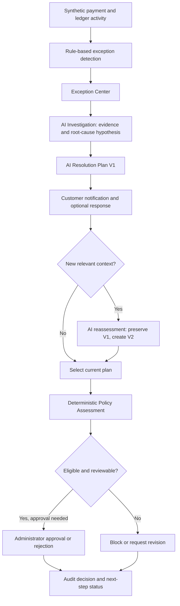
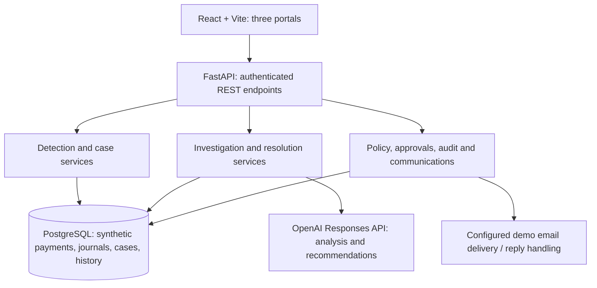

# IntelliOps — AI-Powered Banking Exception Management

**Team:** CoreVista  
**Event:** OCBC Innovation Challenge, November 2026  
**Status:** Completed hackathon prototype  
**Environment:** Synthetic banking data; not connected to live banking systems

> IntelliOps is a student-built proof of concept, not an official OCBC product. Customer identities, payments, accounts, and ledger records in the banking simulation are fictional. Real email delivery, where configured, is for controlled demonstrations and does not imply a live banking integration.

## Overview

IntelliOps helps an operations analyst move from **detecting a payment exception** to **understanding its cause, proposing a response, checking policy, obtaining a human decision, and recording the audit history**. The AI explains evidence and proposes actions; deterministic checks and authorized people control decisions. It is **AI-assisted**, not an autonomous financial-remediation agent.

We built two supporting portals to make the demonstration verifiable:

| Portal | Purpose |
| --- | --- |
| **IntelliOps** | Exception Center, AI Investigation, Resolution Workspace, Approval Center, Audit Trail |
| **Payment Processing** | Create synthetic transfers; inspect transactions, attempts, statuses and processing events |
| **Core Banking / Ledger** | Inspect fictional accounts, balances, journals and debit/credit entries |

These portals refer to connected synthetic payment and ledger records, allowing a reviewer to trace a case back to its source.

## What we built

1. **Automated exception detection:** Rule-based checks classify five categories, with case deduplication, severity/status rules, detected-at timestamps, a manual **Scan Now** control, and detection following synthetic payment activity.
2. **Exception Center:** Search, filters, pagination, status/severity indicators, transaction references, and a case-details drawer showing financial and technical evidence.
3. **AI Investigation:** FastAPI retrieves read-only source evidence, builds an allowlisted LLM input, calls OpenAI Responses, validates the returned report, and stores accepted investigations for authenticated history retrieval.
4. **AI Resolution Plans:** AI-assisted next-step recommendations tied to a saved investigation. Reassessment can produce **Version 2** using newly received customer context, while retaining **Version 1** for comparison.
5. **Customer Communication:** Incident notification, customer reply tracking, chronological conversation, and plan-staleness awareness when a new customer response arrives. The final demo used a controlled real-email/Gmail communication path; this is not a banking customer-messaging integration.
6. **Deterministic Policy Assessment:** Six explicit checks decide whether a proposal is sufficiently supported and whether human approval is required. A model cannot override policy.
7. **Approval Center:** Administrator review and approve/reject decisions. Approval means **Approved — Awaiting Action**, not that money was reversed or a case resolved.
8. **Audit Trail:** Case-linked records of important operational, investigation, communication, policy and approval events.

**Important boundary:** The completed demo stops at the approval/decision and audit stages. It does **not** automatically reverse a payment, correct the ledger, verify a financial correction, or claim the exception is closed after approval.

## End-to-end flow



### Plan versioning and customer context

- Plan V1 is based on the saved investigation and evidence available when it was generated.
- Customer replies are recorded as **additional input**, not as proof that the financial records changed.
- A new reply may make V1 stale. The analyst can generate V2; the older plan remains visible.
- Policy assessment must evaluate the **selected latest non-stale plan**. It must never imply a response was already considered by an earlier model call.
- Customer communication is contextual: not every operational exception requires a customer response.

## Six deterministic policies

| ID | Rule |
| --- | --- |
| **POL-001 — Current Resolution Plan** | Only the latest, non-stale plan can proceed. |
| **POL-002 — Verified Investigation** | An accepted investigation must support the plan. |
| **POL-003 — Financial Evidence** | Financial-correction review requires sufficiently verified and current financial evidence. |
| **POL-004 — Action Eligibility** | The action must be supported and consistent with verified facts. |
| **POL-005 — Approval Authority** | Financially sensitive correction proposals require Administrator approval. |
| **POL-006 — Customer Communication** | Required communication and relevant responses must be considered; an optional unanswered message must not unnecessarily block review. |

The AI may recommend an action, but **it cannot approve itself or execute financial corrections**. Policy checks use backend-controlled evidence and rules, not the LLM's confidence alone.

## Supported exception categories

| Category | Example evidence or issue |
| --- | --- |
| **Duplicate Transaction** | Similar requests or repeated execution; a flagged pair is not automatically a confirmed duplicate. |
| **Amount Mismatch** | Payment amount differs from posted ledger amount, including fee/partial/scaling errors. |
| **Missing Ledger Posting** | Payment marked completed but a corresponding committed journal is absent. |
| **Payment Processing Failure** | Processor unavailable, clearing rejection or account restriction during processing. |
| **Unmatched Transaction** | Payment and ledger references do not reconcile despite potentially valid entries. |

Severity is classified from currently available evidence: **Critical** for widespread/ongoing severe impact; **High** for confirmed or credible financial discrepancy; **Medium** for suspicious/unresolved issues without established loss; **Low** for safely contained or verified harmless cases. Detection does not secretly receive the simulated scenario's expected diagnosis.

### Three duplicate-transaction cases used to validate AI Investigation

| Case | What the *source evidence* showed | Accepted investigation direction | Human-review action |
| --- | --- | --- | --- |
| `CASE-000010` (A) | Customer repeat held, one SGD 25 posting | Genuine held repeat; no double posting | `CLOSE_HELD_DUPLICATE` |
| `CASE-000011` (B) | ACK timeout, system retry, idempotency lookup miss despite prior execution; two SGD 10 postings | System-induced duplicate execution | `ESCALATE_DUPLICATE_FINANCIAL_EXECUTION` |
| `CASE-000009` (C) | Separate authorizations, two SGD 3.33 postings | Legitimate separate instructions | `REVIEW_FALSE_POSITIVE_CLOSURE` |

These accepted reports were obtained through controlled real-model tests and saved for history retrieval. They demonstrate those specific cases, **not guaranteed correctness on all future cases**. Cases require analyst review; no accepted report authorizes a ledger mutation.

## How AI evidence is kept separate from scenario answers

The simulator creates operational events, but the LLM is **not** sent the generator's selected scenario, expected root cause, expected action, or legacy heuristic verdict.

1. The investigator reads a **repeatable-read, read-only** database snapshot and releases the transaction before contacting the model.
2. A separate projection transmits exactly four top-level sections: `snapshot`, `financial_verification`, `evidence_references`, and `retrieved_at`.
3. The snapshot includes relevant payment/request relationships, timestamps, processing events, journal references, and entries—not private scenario labels or expected answers.
4. The model returns structured root-cause hypotheses, explanations, citations and a proposed review action.
5. Server-side validation checks citation IDs, supported money amounts and chronology, financial consistency, diagnosis/action compatibility, and uncertainty safeguards. Invalid output is rejected rather than silently repaired.

Stable citation identifiers let analysts check the source material. A valid citation ID alone does not prove the model's sentence is true; this is why human review remains essential.

## Technical architecture



| Layer | Technology |
| --- | --- |
| Frontend | React, JavaScript/JSX, Vite, React Router |
| Backend | Python, FastAPI, SQLAlchemy, Pydantic |
| Persistence | PostgreSQL; SQL migrations/Alembic-managed schema history where applicable |
| Generative AI | OpenAI Responses API; structured outputs and application validation |
| Deterministic controls | Python detection, accounting checks, policy and role authorization |
| Testing | Python `unittest`, frontend tests/build, Playwright browser checks |

This is a modular backend and frontend application, **not a LangGraph-powered autonomous agent system**. Do not describe it as automatically performing corrective financial transactions.

## Roles, statuses and action boundaries

- **Analyst:** Inspect exceptions, request investigation or resolution recommendations, manage communication, assess plans and submit proposals for approval.
- **Administrator:** Review, approve or reject sensitive proposals within the configured authorization workflow.

Exception Center operational statuses used in the prototype:

`OPEN` → `IN PROGRESS` → `PENDING APPROVAL` → `APPROVED — AWAITING ACTION`

A rejected submission is represented as `REJECTED — NEEDS REVISION`. **Approved** is not equivalent to **Executed**, **Resolved**, or **Closed**.

## Run locally

The repo has two application directories, `backend/` and `frontend/`. Use the committed environment templates and module-specific READMEs as the definitive configuration references; values vary by team machine/database.

**Prerequisites:** Python environment with backend requirements installed, Node.js/npm, access to the configured synthetic PostgreSQL dataset, and authorized demo credentials. An OpenAI key is only needed to **run new paid model calls**, not to view stored reports.

From the repository root, in separate PowerShell terminals:

```powershell
# Backend
Set-Location backend
python -m uvicorn main:app --reload --host 127.0.0.1 --port 8000
```

```powershell
# Frontend
Set-Location frontend
npm.cmd install
npm.cmd run dev -- --host 127.0.0.1 --port 5173
```

Open **http://localhost:5173**, sign in using the team-provided demo role credentials, and use the portal switcher. If your Python environment is in a different location, adjust the Python invocation accordingly.

**Configuration cautions:**

- Copy only safe names/placeholders from `backend/.env.example`; keep `.env`, tokens, OpenAI keys, email credentials and DB URLs out of Git.
- Durable investigation history requires its approved SQL schema (`backend/sql/001_investigation_records.sql`) to exist before enabling `INTELLIOPS_INVESTIGATION_PERSISTENCE=true`. **Do not blindly rerun migration scripts or seed/import scripts against a populated shared database.**
- Opening saved investigation history uses authenticated GETs and **does not call OpenAI**. An explicit **Start AI Investigation** or AI reassessment may make a paid request.
- Real email functionality needs separate configured credentials/recipient controls. Only send to authorized test inboxes.
- If the database is inaccessible, check the configured host, network restrictions and local connectivity before changing connection strings.

### Useful verification commands

```powershell
# From backend/
..\venv\Scripts\python.exe -B -m unittest discover -s tests -p 'test_investigation*.py' -q
..\venv\Scripts\python.exe -B -m unittest discover -s tests -p 'test_payments.py' -q

# From frontend/
npm.cmd test
npm.cmd run build
```

Opt-in live-source or deployed-browser tests may require explicit environment flags and credentials. Their absence should not be treated as test failure. Do not run paid evaluations or mutate a shared demo dataset merely to verify that the UI starts.

## Demo walkthrough

1. In **Payment Processing**, create a synthetic system-retry duplicate; inspect the original and repeated payment.
2. In **Core Banking / Ledger**, show the two posted journals and their individual debit/credit entries.
3. In **IntelliOps → Exception Center**, see the detected case and open its evidence/details.
4. Open **AI Investigation** and review the supported cause, accounting facts and source citations.
5. In **Resolution Plans**, generate/review V1, then open **Customer Communication** and send a controlled incident message.
6. Record the customer's reply and return to the plan to **reassess**; V1 remains alongside V2.
7. Review the latest plan under **Policy Assessment**, then submit a permitted proposal to **Approval Center**.
8. As Administrator, approve or reject it; show **Audit Trail** and the resulting status. **No simulated or real money is automatically reversed.**

## Security and limitations

- Synthetic banking evidence; no live OCBC infrastructure, real customer balances or real payment execution.
- Role-based backend checks for sensitive operations; separate Analyst and Administrator responsibilities.
- Read-only investigation evidence gathering, factual LLM input allowlists and bounded model-output validation.
- Preserved investigation history and plan-version context for review; stale context should trigger reassessment, not silent reuse.
- Deterministic financial/policy decisions rather than allowing model text to execute commands, SQL, transfers or reversals.
- Audit records provide traceability, but do not imply production-grade regulatory certification.
- Narrative truth and unseen-scenario generalization are **not guaranteed** by passing schema/financial checks.
- Financial correction and post-correction verification are **outside the completed hackathon flow** and require a separate controlled process.

---

**Project principle:** *Detect with rules. Investigate with evidence. Recommend with AI. Decide within policy. Keep humans accountable.*
